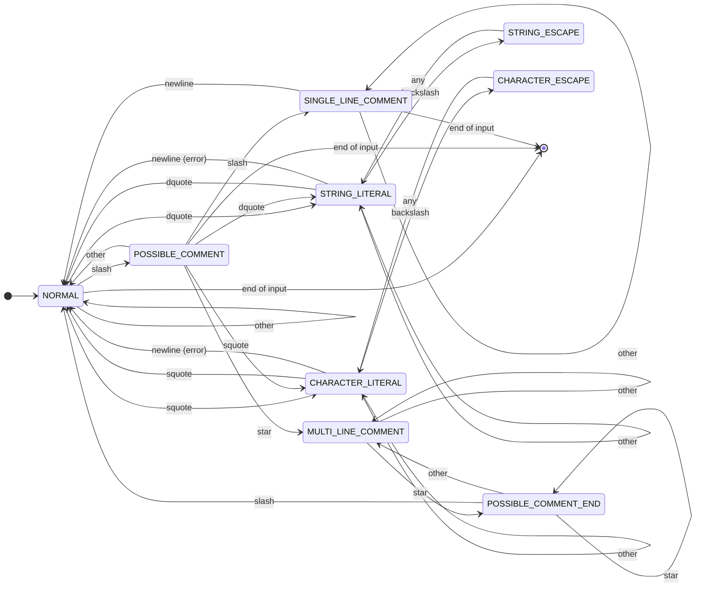

# Comment and Whitespace Remover Using FSM

A Compiler Construction Laboratory mini project. The tool removes comments
and unnecessary whitespace from C-like source code with an explicitly designed
**finite state machine (FSM)**, and shows how the machine reached its result
one transition at a time.

```bash
python3 -m venv .venv
source .venv/bin/activate
pip install -r requirements.txt
streamlit run app.py
```

## Contents

1. [Project overview](#1-project-overview)
2. [Problem statement](#2-problem-statement)
3. [Objectives](#3-objectives)
4. [Features](#4-features)
5. [Introduction to finite state machines](#5-introduction-to-finite-state-machines)
6. [FSM architecture](#6-fsm-architecture)
7. [State definitions](#7-state-definitions)
8. [State-transition table](#8-state-transition-table)
9. [State diagram](#9-state-diagram)
10. [Comment-removal algorithm](#10-comment-removal-algorithm)
11. [Whitespace-processing algorithm](#11-whitespace-processing-algorithm)
12. [String and character literal handling](#12-string-and-character-literal-handling)
13. [Error handling](#13-error-handling)
14. [Processing statistics](#14-processing-statistics)
15. [Technology stack](#15-technology-stack)
16. [Project structure](#16-project-structure)
17. [Installation](#17-installation)
18. [Running](#18-running)
19. [Example programs](#19-example-programs)
20. [Screenshots](#20-screenshots)
21. [Testing](#21-testing)
22. [Limitations](#22-limitations)
23. [Future scope](#23-future-scope)

Further documentation: [architecture](docs/architecture.md),
[FSM design](docs/fsm-design.md),
[complete state-transition table](docs/state-transition-table.md) and
[algorithms](docs/algorithms.md).

### Where things are implemented

| Question | Answer |
|---|---|
| Where is the FSM implemented? | [`remover/fsm.py`](remover/fsm.py) (the engine) |
| Where are the states defined? | [`remover/states.py`](remover/states.py) |
| Where is the transition logic? | [`remover/transitions.py`](remover/transitions.py) (the transition table) |
| Where is comment removal implemented? | [`remover/comment_remover.py`](remover/comment_remover.py), driving the FSM |
| Where is whitespace normalization implemented? | [`remover/whitespace.py`](remover/whitespace.py) |
| How are comment markers inside strings protected? | The `STRING_LITERAL`, `STRING_ESCAPE`, `CHARACTER_LITERAL` and `CHARACTER_ESCAPE` rows of the transition table copy every character, so `//` and `/*` can never reach `POSSIBLE_COMMENT` from inside a literal. Tests: [`tests/test_strings.py`](tests/test_strings.py), [`tests/test_fsm.py`](tests/test_fsm.py). |

## 1. Project overview

Source code is read by people and by compilers. Comments and layout help the
people; the compiler's lexical analyser throws them away. This project builds
that part of a lexical analyser as a stand-alone, inspectable tool:

- an **FSM engine** that reads the source one character at a time and decides,
  from its current state alone, whether each character is code, comment text or
  part of a string or character literal;
- a **whitespace stage** that then removes or reduces the remaining whitespace
  without ever merging two tokens;
- a **Streamlit interface** that shows the cleaned code next to every
  transition the machine made, the state diagram, statistics and errors.

Everything shown is computed from the actual run on the actual input: there are
no stored outputs, no hand-written traces and no estimated numbers.

## 2. Problem statement

Removing comments looks like a text-replacement job, but it is not. Whether a
`/` starts a comment depends on what comes before and after it:

```c
int ratio = a / b;                     // '/' is division
char *url = "https://example.com";     // "//" inside a string is text
char slash = '/';                      // a character literal
int/**/value = 10;                     // removing the comment must not give "intvalue"
```

Whitespace has the same problem: `int x = 10;` may become `int x=10;` but
never `intx=10;`, and the spaces inside `"a    b"` belong to the string.

The problem is to remove comments and unnecessary whitespace **without changing
the meaning of the program**, to detect malformed input (a comment or literal
that never ends) and report where it is, and to make the process visible.

## 3. Objectives

1. Design a deterministic finite state machine that recognises C comments,
   string literals and character literals, including escape sequences.
2. Implement it as an explicit transition table and an engine that consumes
   exactly one character per transition and records every transition.
3. Remove `//` and `/* */` comments while preserving literals, division
   operators and the boundaries between tokens.
4. Process whitespace in three modes (preserve, normalize, compact) and line
   breaks in three modes, without merging identifiers, keywords, numbers or
   operators.
5. Report lexical errors with line and column, recover, and keep processing.
6. Visualise the machine: transition log, step-by-step execution, state
   diagram and statistics, all derived from the real run.
7. Verify the behaviour with automated tests.

## 4. Features

**FSM engine**
- 9 states, 7 input classes, a complete 63-entry transition table plus an
  end-of-input rule for every state, validated before use.
- One character per transition, no lookahead; every source character appears
  in exactly one transition record.
- Line and column tracking for LF, CR LF and CR line endings.

**Comment removal**
- `//` and `/* */` comments; `/*` inside a comment is reported as a warning
  because C comments do not nest.
- String and character literals with backslash escapes are copied unchanged,
  including any `//` or `/*` inside them.
- A removed comment never merges the tokens around it.

**Whitespace processing**
- Whitespace modes: *Preserve*, *Normalize*, *Compact*.
- Newline modes: *Preserve original newlines*, *Preserve line structure*,
  *Normalize blank lines*.
- Token-boundary rules from C's lexical grammar (`int x`, `a - -b`, `x / *p`,
  `0xE + 1`, `L "x"`), preprocessor-aware compact mode, backslash
  continuations kept intact.

**Errors and statistics**
- Lexical structure errors, input validation errors and processing errors, each
  with a precise message, location and recovery note.
- Statistics computed from the run: characters, lines, comments, literals,
  whitespace removed, transitions, characters consumed per state.

**Interface and tooling**
- Streamlit UI with source editor, file upload, example loader, cleaned output
  with download and diff, FSM states, transition log (CSV export),
  step-by-step execution, state diagram, statistics and errors.
- Command-line interface: `python -m remover file.c`.
- Works offline once the dependencies are installed.

## 5. Introduction to finite state machines

A **deterministic finite automaton** (DFA) is a 5-tuple
M = (Q, Σ, δ, q₀, F): a finite set of states Q, an input alphabet Σ, a
transition function δ : Q × Σ → Q, a start state q₀ and a set of accepting
states F. It reads its input one symbol at a time; the only thing it remembers
is its current state.

A **finite-state transducer** (Mealy machine) also writes output on every
transition: λ : Q × Σ → Γ\*. That is exactly what a comment remover needs. For
each character it must decide both *where to go next* and *what to write*: copy
the character, drop it, or hold it until the next character settles what it is.

FSMs are the standard model for **lexical analysis**. Comments, string literals
and identifiers are regular languages, so a DFA recognises them in a single
left-to-right pass, in time proportional to the input and with constant memory.
Lexer generators such as lex and flex compile regular expressions into such
automata; this project writes the automaton by hand so that every state and
transition can be inspected.

The key idea is that **the current state decides how a character is read**. The
same `/` is a division operator in `NORMAL`, the second half of `//` in
`POSSIBLE_COMMENT`, plain text in `STRING_LITERAL` and the end of a comment in
`POSSIBLE_COMMENT_END`.

## 6. FSM architecture

The comment remover is the Mealy machine M = (Q, Σ, Γ, δ, λ, q₀, F) with

| Symbol | In this project |
|---|---|
| Q | the 9 states of [`State`](remover/states.py) |
| Σ | all characters, grouped into the 7 input classes below |
| Γ | output characters |
| δ, λ | [`TRANSITION_TABLE`](remover/transitions.py): next state and output action for every (state, input class) |
| q₀ | `NORMAL` |
| F | `NORMAL`, `POSSIBLE_COMMENT`, `SINGLE_LINE_COMMENT`: the states in which the input may end |

Characters that the machine treats identically form an **input class**, so the
table needs 9 × 7 = 63 entries instead of one per Unicode character:

<!-- BEGIN GENERATED: input-classes -->
| Input class | Characters |
|---|---|
| `/` | the slash '/' |
| `*` | the asterisk '*' |
| `"` | the double quote '"' |
| `'` | the single quote "'" |
| `\` | the backslash '\' |
| newline | a line-feed '\n' or carriage-return '\r' character |
| other | any other character (letters, digits, spaces, tabs, operators, Unicode) |
<!-- END GENERATED: input-classes -->

The engine ([`remover/fsm.py`](remover/fsm.py)) is a loop over the source:

```text
state ← NORMAL
for each character c of the source:
    t ← TRANSITION_TABLE[state, class(c)]       # δ and λ in one lookup
    apply t.output                              # emit, discard, hold or release
    record (position, c, state, t.next_state, t.output, t.action, ...)
    state ← t.next_state
apply END_OF_INPUT[state]                       # finish or report an error
```

**No lookahead.** When the next character is needed to decide (is this `/` a
comment?), the machine moves to an intermediate state and decides on the next
step. A held `/` sits in a one-character buffer that is non-empty exactly while
the machine is in `POSSIBLE_COMMENT`, so the state alone determines it and the
machine stays finite. The engine checks this invariant on every step.

**End of input** is handled as one final pseudo-transition on a virtual end
marker. It is not a character and is not counted as consumed. It releases a held
`/`, closes a `//` comment, or reports an unterminated comment or literal.

## 7. State definitions

<!-- BEGIN GENERATED: states -->
| State | Reads | Input may end here | Meaning |
|---|---|---|---|
| NORMAL | code | yes | The start state. Characters are copied to the output. '/' may start a comment, '"' starts a string literal and "'" starts a character literal. |
| POSSIBLE_COMMENT | pending decision | yes | A '/' was read in code. It is held in a one-character buffer because only the next character can tell whether it starts '//' or '/*' or is just a division operator. |
| SINGLE_LINE_COMMENT | comment | yes | Every character is discarded until a line break, which ends the comment and is itself kept as code. The end of input also ends the comment. |
| MULTI_LINE_COMMENT | comment | no | Every character, including line breaks, is discarded. A '*' moves to POSSIBLE_COMMENT_END because it may start the closing '*/'. |
| POSSIBLE_COMMENT_END | comment | no | Inside a multi-line comment, right after a '*'. A '/' closes the comment, another '*' keeps the possibility open and any other character returns to MULTI_LINE_COMMENT. |
| STRING_LITERAL | string literal | no | Characters are copied unchanged, so '//' and '/*' here are text, not comments. Only an unescaped '"' ends the string. A raw line break is a lexical error. |
| STRING_ESCAPE | string literal | no | The previous character was a backslash, so this character is escaped: it is copied and can never end the string. |
| CHARACTER_LITERAL | character literal | no | Characters are copied unchanged until an unescaped "'". A raw line break is a lexical error. |
| CHARACTER_ESCAPE | character literal | no | The previous character was a backslash, so this character is escaped: it is copied and can never end the literal. |
<!-- END GENERATED: states -->

## 8. State-transition table

Each state's specific inputs are listed first; *any other* covers every
remaining input class. The outputs are: *emit* (copy the character), *skip*
(drop it), *hold* (put the `/` in the buffer), *emit held / + char* (the held
`/` was an operator), *skip both* (the held `/` and this character form a
comment opener) and *emit space* (a closed `/* */` comment is replaced by one
space).

<!-- BEGIN GENERATED: compact-table -->
| Current State | Input | Next State | Output |
|---|---|---|---|
| NORMAL | `/` | POSSIBLE_COMMENT | hold |
| NORMAL | `"` | STRING_LITERAL | emit |
| NORMAL | `'` | CHARACTER_LITERAL | emit |
| NORMAL | any other | NORMAL | emit |
| POSSIBLE_COMMENT | `/` | SINGLE_LINE_COMMENT | skip both |
| POSSIBLE_COMMENT | `*` | MULTI_LINE_COMMENT | skip both |
| POSSIBLE_COMMENT | `"` | STRING_LITERAL | emit held / + char |
| POSSIBLE_COMMENT | `'` | CHARACTER_LITERAL | emit held / + char |
| POSSIBLE_COMMENT | any other | NORMAL | emit held / + char |
| SINGLE_LINE_COMMENT | newline | NORMAL | emit |
| SINGLE_LINE_COMMENT | any other | SINGLE_LINE_COMMENT | skip |
| MULTI_LINE_COMMENT | `*` | POSSIBLE_COMMENT_END | skip |
| MULTI_LINE_COMMENT | any other | MULTI_LINE_COMMENT | skip |
| POSSIBLE_COMMENT_END | `/` | NORMAL | emit space |
| POSSIBLE_COMMENT_END | `*` | POSSIBLE_COMMENT_END | skip |
| POSSIBLE_COMMENT_END | any other | MULTI_LINE_COMMENT | skip |
| STRING_LITERAL | `"` | NORMAL | emit |
| STRING_LITERAL | `\` | STRING_ESCAPE | emit |
| STRING_LITERAL | newline (lexical error) | NORMAL | emit |
| STRING_LITERAL | any other | STRING_LITERAL | emit |
| STRING_ESCAPE | any character | STRING_LITERAL | emit |
| CHARACTER_LITERAL | `'` | NORMAL | emit |
| CHARACTER_LITERAL | `\` | CHARACTER_ESCAPE | emit |
| CHARACTER_LITERAL | newline (lexical error) | NORMAL | emit |
| CHARACTER_LITERAL | any other | CHARACTER_LITERAL | emit |
| CHARACTER_ESCAPE | any character | CHARACTER_LITERAL | emit |
<!-- END GENERATED: compact-table -->

The complete table, one row per (state, input class) plus the end-of-input
rules, with output actions, lexical events and explanations, is in
[docs/state-transition-table.md](docs/state-transition-table.md). Both tables
are generated from the code.

## 9. State diagram

Generated from the transition table (GitHub renders it). Every state can also
end the input; only the three accepting states do so without an error.

<!-- BEGIN GENERATED: mermaid -->

<!-- END GENERATED: mermaid -->

The main paths through the machine, as plain text:

```text
NORMAL --'/'--> POSSIBLE_COMMENT --'/'--> SINGLE_LINE_COMMENT --newline--> NORMAL
                POSSIBLE_COMMENT --'*'--> MULTI_LINE_COMMENT --'*'--> POSSIBLE_COMMENT_END --'/'--> NORMAL
                POSSIBLE_COMMENT --other--> NORMAL                          (the '/' was an operator)
NORMAL --'"'--> STRING_LITERAL --'\'--> STRING_ESCAPE --any--> STRING_LITERAL --'"'--> NORMAL
NORMAL --"'"--> CHARACTER_LITERAL --'\'--> CHARACTER_ESCAPE --any--> CHARACTER_LITERAL --"'"--> NORMAL
```

Not shown in this summary (but in the diagram above): every state loops on the
characters it does not treat specially; `POSSIBLE_COMMENT_END` loops on `*`
and returns to `MULTI_LINE_COMMENT` on anything else; `POSSIBLE_COMMENT` goes
straight into a literal on `"` or `'`; and a line break inside a literal leads
back to `NORMAL` as a lexical error.

The interface draws the full diagram with Graphviz, highlights the transition
taken at each step and shows how many characters were consumed in each state.

## 10. Comment-removal algorithm

[`remover/pipeline.py`](remover/pipeline.py) validates the input, then
[`remover/comment_remover.py`](remover/comment_remover.py) runs the FSM over
the unchanged source and attaches the actions a lexer attaches to its
automaton:

1. Validate the input: it must be text, not binary, within the size limit.
2. Initialise the FSM in `NORMAL` with an empty buffer.
3. Feed the characters one at a time; each step returns a transition record.
4. When a transition signals that a comment starts (`//` or `/*`), open a
   comment lexeme at the position of the held `/`.
5. While in a comment state, the FSM discards characters; they are collected
   into the comment lexeme.
6. On the closing `*/` the FSM writes one space in place of the comment, as C
   compilers do (ISO C11 §5.1.1.2, translation phase 3: "Each comment is
   replaced by one space character"). A `//` comment ends at the line break,
   which is code and is kept.
7. Literals are copied unchanged and recorded as literal lexemes.
8. Line breaks outside comments are kept; inside comments they are discarded
   (the whitespace stage decides later whether to put them back).
9. At the end of input, a held `/` is released, a `//` comment is closed, and an
   open comment or literal is reported as a lexical error.
10. Return the FSM output, the transition log, the comments and literals found,
    the diagnostics and the output split into tagged pieces (code, literal,
    removed comment) for the whitespace stage.

Example: the actual transitions for `a/b/*c*/"/"`:

<!-- BEGIN GENERATED: trace -->
| Step | Char | Current State | Next State | Output | Emitted | Discarded | Buffer |
|---|---|---|---|---|---|---|---|
| 0 | `a` | NORMAL | NORMAL | `EMIT` | `a` |  |  |
| 1 | `/` | NORMAL | POSSIBLE_COMMENT | `BUFFER` |  |  | `/` |
| 2 | `b` | POSSIBLE_COMMENT | NORMAL | `FLUSH_AND_EMIT` | `/b` |  |  |
| 3 | `/` | NORMAL | POSSIBLE_COMMENT | `BUFFER` |  |  | `/` |
| 4 | `*` | POSSIBLE_COMMENT | MULTI_LINE_COMMENT | `DISCARD_BUFFER` |  | `/*` |  |
| 5 | `c` | MULTI_LINE_COMMENT | MULTI_LINE_COMMENT | `DISCARD` |  | `c` |  |
| 6 | `*` | MULTI_LINE_COMMENT | POSSIBLE_COMMENT_END | `DISCARD` |  | `*` |  |
| 7 | `/` | POSSIBLE_COMMENT_END | NORMAL | `REPLACE_WITH_SPACE` | `␣` | `/` |  |
| 8 | `"` | NORMAL | STRING_LITERAL | `EMIT` | `"` |  |  |
| 9 | `/` | STRING_LITERAL | STRING_LITERAL | `EMIT` | `/` |  |  |
| 10 | `"` | STRING_LITERAL | NORMAL | `EMIT` | `"` |  |  |
| 11 | end of input | NORMAL | NORMAL | `NONE` |  |  |  |

FSM output: `a/b "/"`
<!-- END GENERATED: trace -->

## 11. Whitespace-processing algorithm

[`remover/whitespace.py`](remover/whitespace.py) runs after comment removal.
Because it receives the FSM output already split into tagged pieces, it knows
which characters are inside literals (never changed) and where comments were,
without scanning the source again.

It splits each line into *atoms* (runs of code characters, whole literals,
runs of spaces/tabs, removed-comment markers) and makes every decision at a
**gap**, the whitespace and removed comments between two tokens:

| Mode | Indentation | Gap between two tokens | Trailing whitespace |
|---|---|---|---|
| **Preserve** | kept | kept exactly | kept, unless it only separated the code from a removed comment |
| **Normalize** | kept | one space | removed |
| **Compact** | removed | removed, unless the tokens would merge | removed |

Two tokens **would merge** when removing the gap changes how C reads them
(`separator_reason` in `whitespace.py`):

- identifier, keyword or number characters on both sides: `int x`, `return value`;
- two characters that form a longer operator: `a - -b`, `x + +y`, `a & &b`, `>`
  `>` in templates, digraphs;
- a gap that would start a comment: `x / *p`, `a / /b`;
- a literal prefix or suffix: `L "x"`, `"x" _s`;
- a number that would absorb a `.` or an exponent sign: `1 .5`, `0xE + 1`.

Where only a removed comment separated two tokens, one space is kept only if
they would merge: `int/**/value` becomes `int value`, but `f(/**/)` becomes
`f()`. In compact mode, **preprocessor lines are only normalized**, because
whitespace in a directive can matter: `#define F (x) x` and `#define F(x) x`
define different macros.

Line breaks are handled by the **newline mode**:

| Newline mode | Line breaks inside comments | Lines that held only a comment | Blank lines you wrote |
|---|---|---|---|
| **Preserve original newlines** | kept, so every line keeps its line number | become blank | kept |
| **Preserve line structure** (default) | removed with the comment | removed | kept |
| **Normalize blank lines** | removed with the comment | removed | runs collapsed to one; none at start or end |

A line ending in a backslash continuation is never joined to a different line:
a comment-only line after it is kept as a blank line.

`whitespace.c` in the three whitespace modes (normalize, compact; preserve
leaves it unchanged):

<!-- BEGIN GENERATED: example:whitespace.c:normalize -->
```c
int a = 10;
int b = 20;
int sum = a + b;
```
<!-- END GENERATED: example:whitespace.c:normalize -->

<!-- BEGIN GENERATED: example:whitespace.c:compact -->
```c
int a=10;
int b=20;
int sum=a+b;
```
<!-- END GENERATED: example:whitespace.c:compact -->

`multi_line_comments.c` in the three newline modes:

<!-- BEGIN GENERATED: example:multi_line_comments.c:normalize:preserve -->
```c
int a = 10;


int b = 20;
```
<!-- END GENERATED: example:multi_line_comments.c:normalize:preserve -->

<!-- BEGIN GENERATED: example:multi_line_comments.c:normalize:structure -->
```c
int a = 10;


int b = 20;
```
<!-- END GENERATED: example:multi_line_comments.c:normalize:structure -->

<!-- BEGIN GENERATED: example:multi_line_comments.c:normalize:collapse -->
```c
int a = 10;

int b = 20;
```
<!-- END GENERATED: example:multi_line_comments.c:normalize:collapse -->

## 12. String and character literal handling

A `"` in `NORMAL` enters `STRING_LITERAL`; a `'` enters `CHARACTER_LITERAL`. In
these states every character is copied unchanged, so `//` and `/*` inside a
literal are plain text:

```c
char* text = "This contains // and /* markers */";   // kept exactly
char symbol = '/';                                   // kept exactly
```

A backslash moves to `STRING_ESCAPE` (or `CHARACTER_ESCAPE`). The next
character is copied whatever it is and the machine returns to the literal, so
an escaped quote cannot end it:

```c
char* text = "A quote: \" and a slash: \\";   // \" stays inside, \\ lets the final " close it
```

A C literal cannot contain a raw line break. When one appears, the machine
reports an *unterminated literal* at the opening quote, ends the literal at the
line break and continues in `NORMAL`, so one missing quote does not hide the
comments in the rest of the file. Whitespace processing treats every literal as
a single token and never changes it.

## 13. Error handling

| Category | Meaning | Examples |
|---|---|---|
| **Lexical Structure Error** | The source breaks a lexical rule. The scanner reports the location, recovers and keeps going. | unterminated multi-line comment, string literal or character literal |
| **Input Validation Error** | The input cannot be processed at all; the FSM does not run. | not text, contains NUL (binary data), larger than the limit, not valid UTF-8 (upload) |
| **Processing Error** | An internal fault, reported instead of crashing. Indicates a bug, not a source problem. | incomplete transition table, broken buffer invariant, unexpected exception |

Warnings are reported the same way for `/*` inside a comment, an empty
character literal `''`, mixed line endings, empty input and a capped transition
log.

For [`examples/errors.c`](examples/errors.c) the report is:

```text
Lexical Structure Error:
Unterminated multi-line comment.

Location:
Line 3, Column 1

Recovery:
Reached end of input while inside a multi-line comment. Everything from the '/*' to the end of the input was treated as comment text and removed; the output holds only the code before it.
```

The output still contains the code before the comment, and the interface marks
it as possibly incomplete. Locations use 1-based lines and columns; a column
counts characters, so a tab is one column.

## 14. Processing statistics

All statistics are computed from the actual run:

<!-- BEGIN GENERATED: metrics -->
| Statistic | Definition |
|---|---|
| Original Characters | Number of characters in the source as entered. |
| Output Characters | Number of characters in the final cleaned output. |
| Characters Removed | Original Characters minus Output Characters: a plain length difference, so it already accounts for the separator spaces and comment line breaks that are kept. |
| Original Lines | Lines in the source (a final line break does not start a new line). |
| Output Lines | Lines in the cleaned output, counted the same way. |
| Comments Detected | Comments recognised by the FSM (both kinds). |
| Single-Line Comments | Comments starting with //. |
| Multi-Line Comments | Comments starting with /*, including an unterminated one. |
| Comment Characters Removed | Characters inside comments, delimiters included. The line break that ends a // comment is code and is not counted. |
| String Literals | Double-quoted literals preserved unchanged. |
| Character Literals | Single-quoted literals preserved unchanged. |
| Whitespace Removed | Whitespace characters of the code (spaces, tabs, form feeds, vertical tabs and line-break characters outside comments and literals) that are not in the output. A run of N characters reduced to one space counts as N - 1. |
| Separators Inserted | Spaces kept where a removed comment was the only thing between two tokens that would otherwise merge (int/**/x becomes int x). |
| Comment Line Breaks Kept | Line breaks from inside multi-line comments kept in the output (only with 'Preserve original newlines'). |
| Characters Scanned | Characters consumed by the FSM; each exactly once. |
| FSM Transitions | Transitions executed: one per character plus the final end-of-input transition. |
| State Changes | Transitions whose next state differs from the current state (the rest are self-loops). |
| Errors | Error diagnostics reported. |
| Warnings | Warning diagnostics reported. |
<!-- END GENERATED: metrics -->

They satisfy an exact identity, checked by the tests for every example and
mode: *Output Characters = Original Characters − Comment Characters Removed −
Whitespace Removed + Separators Inserted + characters of the comment line breaks
kept*.

## 15. Technology stack

| Purpose | Technology |
|---|---|
| Language | Python 3.11+ (developed with 3.14, also tested with 3.11) |
| FSM engine, comment removal, whitespace processing | Python standard library only |
| User interface | [Streamlit](https://streamlit.io/) (its bundled Graphviz renderer draws the state diagram) |
| Tests | pytest |

No regular expressions, parser generators or lexer libraries are used for
comment or whitespace removal.

## 16. Project structure

```text
.
├── app.py                   Streamlit page: layout and session state
├── ui/
│   ├── html.py              highlighted source, step view, pipeline banner
│   └── views.py             one function per results tab
├── remover/                 the processing engine (no Streamlit imports)
│   ├── states.py            the FSM states and which of them accept
│   ├── transitions.py       input classes and the transition table (δ, λ)
│   ├── fsm.py               the engine: one character per transition
│   ├── comment_remover.py   runs the FSM, collects comments, literals, errors
│   ├── whitespace.py        whitespace and newline modes, token boundaries
│   ├── pipeline.py          validation -> FSM -> whitespace -> statistics
│   ├── models.py            data structures shared by the stages
│   ├── errors.py            error categories and diagnostics
│   ├── text.py              whitespace and line-break helpers
│   ├── diagram.py           diagrams and tables generated from the table
│   ├── display.py           formatting of records, excerpts and CSV
│   └── __main__.py          command-line interface
├── tests/                   pytest suite
├── examples/                example C programs
├── docs/                    architecture, FSM design, full table, algorithms
├── tools/sync_docs.py       regenerates the generated parts of the docs
├── .streamlit/config.toml   offline settings (no telemetry, no e-mail prompt)
└── requirements.txt
```

## 17. Installation

Requirements: Linux (or any OS with Python), Python 3.11 or newer.

```bash
python3 -m venv .venv
source .venv/bin/activate
pip install -r requirements.txt
```

If `python3` is older than 3.11, create the environment with a newer
interpreter instead, for example `python3.12 -m venv .venv`; after activation
`python` and `pip` refer to it. No database, Docker or cloud service is needed,
and nothing is installed globally. After installation the application works
offline.

## 18. Running

**Interface:**

```bash
streamlit run app.py
```

Streamlit prints a local URL (normally <http://localhost:8501>). Enter code or
load an example, choose the modes and click **Process Source**.

**Command line:**

```bash
python -m remover examples/edge_cases.c                 # cleaned code to stdout
python -m remover examples/whitespace.c -w compact      # whitespace mode
python -m remover examples/multi_line_comments.c -n preserve
python -m remover examples/basic.c --trace              # the transition log
python -m remover examples/errors.c --stats             # statistics on stderr
cat program.c | python -m remover -o program.clean.c
```

Errors are printed to standard error with the source line and a caret; the exit
status is 1 if an error was reported.

## 19. Example programs

| File | Demonstrates |
|---|---|
| [`basic.c`](examples/basic.c) | code without comments: every character stays in `NORMAL` |
| [`single_line_comments.c`](examples/single_line_comments.c) | `//` comments |
| [`multi_line_comments.c`](examples/multi_line_comments.c) | a `/* */` comment over several lines |
| [`strings_and_characters.c`](examples/strings_and_characters.c) | comment markers inside literals are preserved |
| [`whitespace.c`](examples/whitespace.c) | the three whitespace modes |
| [`edge_cases.c`](examples/edge_cases.c) | division, a comment between statements, an escaped quote |
| [`errors.c`](examples/errors.c) | unterminated multi-line comment |
| [`literal_errors.c`](examples/literal_errors.c) | unterminated string and character literals with recovery |
| [`complete_program.c`](examples/complete_program.c) | a complete program using every feature |

Default settings (Normalize, Preserve line structure), produced by the tool:

`single_line_comments.c`

<!-- BEGIN GENERATED: example:single_line_comments.c -->
```c
int a = 10;
int b = 20;
int sum = a + b;
```
<!-- END GENERATED: example:single_line_comments.c -->

`strings_and_characters.c` (unchanged: there are no comments)

<!-- BEGIN GENERATED: example:strings_and_characters.c -->
```c
char* url = "https://example.com";
char* text = "This contains // and /* markers */";
char symbol = '/';
```
<!-- END GENERATED: example:strings_and_characters.c -->

`edge_cases.c`

<!-- BEGIN GENERATED: example:edge_cases.c -->
```c
int a = 10 / 2;
int b = 10; int c = 20;
char* text = "escaped quote: \"";
```
<!-- END GENERATED: example:edge_cases.c -->

`literal_errors.c` (two errors reported; the comment on line 3 is still removed)

<!-- BEGIN GENERATED: example:literal_errors.c -->
```c
char* greeting = "Hello;
char symbol = 'a;
int total = 0;
```
<!-- END GENERATED: example:literal_errors.c -->

`complete_program.c` cleaned in every mode combination compiles with
`gcc -std=c11 -Wall -Werror` and prints exactly what the original prints; the
test suite checks this whenever a C compiler is installed.

## 20. Screenshots

_Add screenshots of the running application here, for example in
`docs/screenshots/`:_

- _the editor with the processing pipeline after loading `complete_program.c`;_
- _the Cleaned Output tab with the side-by-side comparison;_
- _the Step-by-Step tab in the middle of a comment;_
- _the State Diagram tab;_
- _the Errors tab for `errors.c`._

## 21. Testing

```bash
pytest -v
```

The suite runs without a network connection and without starting a browser:

| File | Covers |
|---|---|
| `test_fsm.py` | initial state, every kind of transition, buffering, escapes, end of input, positions, the transition log |
| `test_transitions.py` | completeness and validation of the table, the documented rows |
| `test_comment_remover.py` | comment and literal records, pieces, diagnostics, log capping |
| `test_single_line_comments.py`, `test_multi_line_comments.py`, `test_strings.py` | comment removal and literal protection through the pipeline |
| `test_whitespace.py` | the whitespace and newline modes, token boundaries, accounting |
| `test_edge_cases.py` | empty input, odd slashes, adjacent comments, malformed input, Unicode, line endings, validation |
| `test_pipeline.py` | the end-to-end workflow, options, statistics identity, error reporting, independence from Streamlit |
| `test_examples.py` | every example in every mode; the cleaned demo program compiles and behaves like the original (needs `gcc`, `clang` or `cc`; skipped otherwise) |
| `test_diagram.py`, `test_display.py`, `test_cli.py` | generated diagrams and tables, formatting, the command line |
| `test_ui.py` | the HTML fragments and the Streamlit app, driven by Streamlit's `AppTest` |
| `test_docs.py` | the generated parts of the documentation match the code |

## 22. Limitations

- **Language.** The lexical rules implemented are those of C (C99 and later):
  `//` and `/* */` comments, `"..."` and `'...'` literals with backslash escapes.
  C++, Java, C# and JavaScript code that follows the same rules is processed
  correctly, but these are not supported: C++ raw strings (`R"(...)"`),
  JavaScript template literals and regular-expression literals, Java text
  blocks, and `#` comments of Python or shell scripts.
- **Apostrophes outside literals.** A C23/C++14 digit separator (`1'000`) or an
  apostrophe in an `#error` message starts a character literal.
- **Line splicing.** C joins a line ending in a backslash to the next line
  before removing comments, so a `//` comment ending in `\` continues on the
  next line. This tool does not splice lines (GCC warns about such comments with
  `-Wcomment`). A backslash-newline inside a string literal does continue the
  string, except with CR LF line endings, where it is reported as an
  unterminated string. Trigraphs are not supported.
- **Nested comments** are not supported, by design: C comments do not nest, and
  the tool warns when it sees `/*` inside a comment.
- **Compact mode** is conservative: it may keep a space that is not strictly
  needed. It can change the text produced by the `#` stringizing operator for
  macro arguments (`STR(a + b)` gives `"a + b"`, after compacting `"a+b"`).
- **Preserve original newlines** keeps the line breaks inside multi-line
  comments. In the rare case of a multi-line comment inside a preprocessor
  directive that is followed by more directive text on its last line, this
  splits the directive, whereas C replaces the whole comment by one space. The
  other two newline modes follow C.
- **Not a compiler.** The tool does not check syntax; any character that is not
  part of a comment or literal is copied through.
- **Size.** Input is limited to 200,000 characters by default
  (`ProcessingOptions.max_input_characters`), and the interface records at most
  50,000 transitions; the output and statistics always cover the whole input.

## 23. Future scope

- **Other languages** through additional transition tables: the engine already
  accepts any complete table (`CommentFSM(table=..., eof_table=...)`), so a
  Python table with `#` comments and triple-quoted strings could be added.
- **Line splicing** as an extra state, to follow C translation phase 2 exactly.
- Raw strings, template literals and digit separators with additional states.
- Options to keep documentation comments (`/** */`, `///`) or licence headers.
- A full token stream (identifiers, numbers, operators), turning the tool into a
  complete lexical analyser.
- Exporting the step-by-step trace as an animation for teaching.
